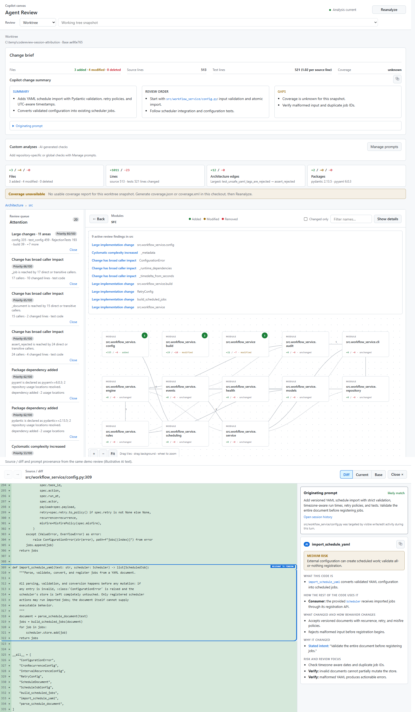

# Agent Review

A GitHub Copilot Canvas extension for reviewing agent-made changes in Python,
Node.js/TypeScript, C#/.NET, Go, Rust, and Markdown repositories. Start with the change's intent and architecture,
then follow its impact down to findings, dependency evidence, and source diffs.

[](docs/agent-review.png)

*Two views of the same demo review: architecture and attention above; source,
prompt provenance, and briefing below. AI text and prompt provenance are
illustrative; changes, graph, and findings come from the analyzer. Click to enlarge.*

## Evaluation projects

The four [review test projects](test-repos/) used for large-change and UX
validation are checked in as portable source fixtures. Each guide describes
the intended change, what to evaluate, explicit test/coverage commands, and
which evidence must remain unknown or inferred.

| Project | Evaluate |
|---|---|
| [Large repository](test-repos/large-repo/README.md) | 642 changed files, internal evidence consolidation, implementation cohorts, unchanged consumers, oversized source, and two planted regressions |
| [Node.js / TypeScript](test-repos/node-demo/README.md) | npm workspaces, JS/TS/JSX/TSX graph and package changes, isolated tests, and exact-source coverage |
| [Python coverage](test-repos/coverage-demo/README.md) | Inferred versus confirmed paths, aggregate coverage, intentionally untested exits, and exact source-location discussion |
| [C# / .NET](test-repos/dotnet-demo/README.md) | Partial classes, interfaces, threshold contracts, NuGet locks, xUnit outcomes, and aggregate-only coverage |

From this checkout, create each sample in a **new directory outside this
repository**:

```powershell
node .\test-repos\prepare.mjs large-repo C:\temp\agent-review-large-repo-sample
node .\test-repos\prepare.mjs node-demo C:\temp\agent-review-node-demo-sample
node .\test-repos\prepare.mjs coverage-demo C:\temp\agent-review-coverage-demo-sample
node .\test-repos\prepare.mjs dotnet-demo C:\temp\agent-review-dotnet-demo-sample
```

The preparer recreates independent local Git baselines without copying nested
Git metadata, caches, dependencies, or machine-specific coverage reports.
Existing destinations are rejected, including the original validation repos.
Setup never installs dependencies, runs tests, or changes your extension.
Open the printed directory with **Change repository** in Agent Review.
The large project uses committed `main` / `large-change` targets; the other
three leave their feature changes uncommitted for **Worktree** review against
`HEAD`. Do not review the fixture directories as if they were standalone repos.

Run the setup/regression checks with `node --test test-repos/tests/prepare.test.mjs`.
The large sample's two failing tests are intentional; its guide identifies them.

## Features and insights

### Review agent instructions

Markdown reviews preserve both saved versions and parse headings, frontmatter,
lists, links, fenced examples, and quotations into line-addressable evidence.
Recognized entry points include `SKILL.md`, `AGENTS.md`, `CLAUDE.md`, `GEMINI.md`,
and Copilot instruction files. An explicit instruction to follow a local
reference can establish its intended instruction role; a bare link establishes
only supporting material. An imperative in an ordinary README does not turn it
into an agent instruction.

The **Evidence** pane shows the document role, its classification evidence,
and incoming reference paths, with links to the correct saved source side.
**Correct document role** saves a reviewer interpretation for this snapshot;
**Reset to analyzer** removes it. Corrections persist in the session workspace
and invalidate derived AI interpretations, not file-review decisions or source
documents. Providers without a workspace explicitly identify memory-only storage.
Conflicting saves are rejected rather than silently overwriting another tab.

Markdown explanations compare prescribed obligations, evidence requirements,
required stops, permissions, and conditional exceptions instead of inventing
functions or callers. Supporting documents and quoted examples remain distinct
from active rules. Missing local files and heading fragments are deterministic
checks; contradictions and predicted failure scenarios are AI interpretations.
No controlled agent evaluation is run by this adapter. Repository test results
and code coverage do not measure instruction compliance.

Bounded explanation context prioritizes changed lines from every diff hunk and
the direct instruction that references the document. If changed source cannot
fit, the context lists the omitted line ranges. Source citations identify the
saved `base` or `current` version and open that side in the source viewer.

References resolve only within each saved snapshot, never by fetching external
URLs or executing embedded commands. Structure and relationship limits are
reported as evidence gaps. Literal module-relative JavaScript file reads into
an `instructions` field can establish intended supply; literal copy operations
establish packaging only. Other dynamic loading contracts remain unverified.
A reference, loader, or packaging step does not prove an agent received, read,
or obeyed the document. Document precedence remains unknown without an explicit
host or loading contract. Automatic instruction repair, arbitrary skill
execution, and a general prompt-evaluation framework are outside this feature.

Run Markdown regressions with
`python -m unittest discover -s .github/extensions/agent-review/tests -p test_markdown_adapter.py`
and `node --test .github/extensions/agent-review/tests/test-markdown.mjs`.
The attributed Radius fixture records the upstream base/head revisions.
For interactive real-repository coverage, set `AGENT_REVIEW_UX_REPO` and
`AGENT_REVIEW_MARKDOWN_PATH` to an explicitly referenced changed instruction
document, then run
`node .github/extensions/agent-review/tests/browser/markdown-review.mjs`
with the browser-tooling settings below. Controlled responses in this browser
test exercise presentation, not semantic instruction compliance.

### Understand the change

**Worktree** compares the saved working tree with the configured comparison
base, not necessarily `HEAD`. A stale local `main` can therefore include years
of committed history even in a clean worktree. Use `origin/main` for the current
remote-tracking baseline, or `HEAD` to review only uncommitted changes, when
that is the intended scope. Agent Review does not silently replace an explicit
baseline.

A compact Overview keeps **Start review** or **Continue review**, focused-queue
progress, and access to every changed file in the first screen. Priority items
are a starting point, not a claim that all changed code has been reviewed.
**Change summary, intent and advanced checks** opens the full narrative,
metadata, metrics, provenance and custom-check controls when needed.

The **Review** workspace keeps a **Groups / Files** navigation spine beside the
saved source. **Groups** reads the change as ordered **layers**: areas of code
(for example backend, utilities, user interface) ordered foundations-first by
the saved call and import relationships between them, with "builds on" links.
Each layer carries one short, AI-labelled sentence describing what the change
does there, generated once from that layer's saved diffs; until it arrives (or
when Copilot is unavailable) the layer lists its changed symbols instead.
Animated line bars identify pending AI work, including layer summaries,
overview refinement, explanations, background review and discussion answers;
reduced-motion preferences keep the bars static. Layer headers expand or
collapse their file lists; **Review layer** opens the next unreviewed file.
Indented, bordered file buttons open a diff, with the current file clearly
highlighted. The first explanation is prefetched after the overview settles,
then the next one while reading. Opening an in-flight prefetch joins the same
request; failures are shown and opening that file retries the explanation.
To check these interactions against a real changed repository, set
`AGENT_REVIEW_UX_REPO` and run
`node .github\extensions\agent-review\tests\browser\review-prefetch.mjs`
with the browser-tooling settings described below. It uses the production
analyzer and server with controlled AI responses; it does not change that
repository or call a model.
Within a layer each changed file appears exactly once, with its consumers and
tests listed beneath it and tagged by role (consumer, test, import-linked, or
name-matched test); identical implementations across many files stay one
group, and supporting files form a final layer. The file count includes every
changed file.
**Impact** opens within the same review; **Return to code** restores the source
side, reading position and item context. **Overview / Review** lets you return
to the change story without discarding the current reading point.
Advanced concern inventories, architecture, code paths and dependency exploration
remain under **Explore** rather than competing as primary review routes.
On narrow canvases, **Code** and **Context / Discussion** are focused panes, with
the change navigator in a keyboard-accessible drawer.
Context foregrounds the change mechanism, source-backed potential consumers,
actual verification and open evidence gaps. Static test associations, named-test
execution and aggregate coverage remain distinct; repository test outcomes alone
never prove a particular path ran. When a supplied coverage run measured the
open file, the current-side gutter marks each executed and not-executed line and
item discussion receives those exact line ranges. **Ask about this** is available beside the
reading-pane controls, and the context/discussion switch stays visible while
reading. Originating-session context (the Copilot request that produced the code)
sits directly beneath the AI explanation and its risk assessment; errors
remain explicit. **Focus code** also hides the decision footer while reading.

Whole-file review decisions have a clear finish line: **Not reviewed**,
**Reviewed**, or **Needs follow-up**. **Mark file reviewed & next** records a
whole-file decision and advances only after the save succeeds. File notes and
the reading point are stored in the Copilot session workspace, independently of
the canvas's local server port; a provider without a workspace explicitly
identifies memory-only storage. Whole-file decisions are the single measure of
progress: the focused priority queue derives its progress from them, and the
optional per-concern triage (accepted risk, false positive, follow-up) explains
why a concern was set aside without marking files reviewed.
**Review all group files** requires an explicit scope confirmation and preserves
existing notes. **Finish** lists pending work, follow-ups, retained finer-grained
decisions and verification limits. Human completion does not resolve findings,
complete AI analysis, establish coverage, or prove correctness.

**Finish → Preview / export handoff** previews the exact Markdown before
downloading it or exporting portable decision-state JSON. Both include file
names and saved human notes, but no source bodies, AI explanations, originating
prompts or discussion transcripts. The JSON is not a source archive or a durable
canvas link: reopen the original saved snapshot, then preview and confirm the
import. Content identity is independent of the repository's local directory;
different content or conflicting existing decisions is rejected, not replaced
with newer worktree source. Binary/unsnapshotted worktree content cannot be
verified for portable import and is explicitly unsupported.

**Line comments.** Click a changed line's number, press **C**, or use **Comment**
to draft a comment under that line (Ctrl+Enter saves, Esc cancels). Several
drafts can be open at once and typed text is never discarded implicitly. Drafts
are saved in the session workspace per snapshot and are revision-checked across
tabs. On a commit or worktree review they are included in the handoff Markdown.

For a loaded GitHub PR, existing review threads appear under their lines (threads
on other commits are grouped separately), marking a file reviewed toggles
GitHub's per-file **Viewed** checkbox, and the same preview submits one review
through the existing `gh` CLI authorization: the reviewer's optional summary,
the Agent Review summary and the drafted line comments, as an explicitly chosen
**Comment**, **Approve** or **Request changes** verdict (GitHub forbids the last
two on your own PR). Only lines inside GitHub's own PR diff can take comments.
The original commit is pinned and the PR head is rechecked: once the PR has newer
commits, commenting, Viewed sync and submission pause until the PR is reopened.
Changed targets/decisions/drafts, stale previews and duplicate submissions are
rejected. A network failure may leave the remote outcome unknown: check the PR
before preparing another submission. Local and commit reviews remain fully
usable without creating a PR.

A change brief shows file mix, source/test churn, coverage availability, and the
originating request. Copilot uses bounded, saved implementation and test excerpts
to explain behavior changes, suggest a review order, and distinguish demonstrated
cases from evidence gaps. Clickable metrics include all reviewable files, not
just analyzed source languages.

Generated or minified files (built bundles, `*.min.*`, source maps, and JS/CSS
whose lines are machine-length) remain reviewable as files but are not parsed
for symbols, sit under **Supporting files** instead of leading the reading path,
and unchanged ones are not copied into the review. A repository that commits its
build output therefore stays within the analyzer's bounded model size.

The default **Review plan** ranks changed callables and dependencies by rule-based
impact, churn, caller reach, and the strongest available test evidence. It updates
after linked tests run and opens the highest-risk unreviewed or follow-up path
directly in source. The architecture graph remains available for exploratory
drill-down.

**Verify a layer.** Beside the code, *What was verified?* offers to run just the
current layer's linked tests (an explicit action that executes repository code,
in the worktree or a disposable snapshot export). Results from successive layers
accumulate for the snapshot: the rail and Finish show each layer's outcome, and
where the language supports per-test line tracing, gutter dots mark the changed
code paths a linked test executed, reached only through failing tests, or never
reached. Cancelling or a failed layer run keeps the earlier evidence. Because a
layer is usually one language, this also verifies mixed-language reviews layer
by layer. The handoff lists each layer's linked-test outcome and every run.

### Follow architecture and impact

Drill from components to modules, classes, functions, and relationships. Added,
modified, and removed items have distinct styling; graph edges expose callers
and dependencies. Resizing relayouts the existing graph without rebuilding the
review panels, preserving keyboard focus, dragged tiles, and user-controlled
pan/zoom. A ranked attention queue highlights rule-based concerns,
with evidence, exact source locations, and persistent **Close / Reopen** controls.
Snapshot-scoped review dispositions and source-line notes record reviewed,
follow-up, accepted-risk, and false-positive decisions. Progress survives
reanalyzing unchanged source and is isolated automatically when reviewed source
changes.
Analysis limitations are a readable list of static-analysis notes, with plain
explanations and clickable saved source/project locations. Baseline/current and
target-framework labels distinguish their scope; unresolved graph links are
not automatically classified as runtime bugs.

### Follow code paths

The **Code paths** metric maps how each changed production function behaves:
its returns, raises, skipped iterations, error handlers, and name-based wiring
(for example, a checker loaded from a class-name string), each with its
governing condition. **Only if** marks gates that apply only when a value is
present, thresholds are called out, and added exits show which existing exit
runs before and after them, revealing fallbacks an earlier return can preempt.
Compared with the base, code paths are added, removed, changed (such as a
threshold moving from 0.9 to 0.95), or moved. Select any path to open its
line; the source pane lists the paths for the selected function, class, or
file below the Copilot briefing. Copilot summaries and briefings receive the
same deterministic map.

### See which paths are tested

Every changed path carries its test evidence, and filters show **Untested**,
**Inferred**, or **Confirmed** paths. Static analysis links tests that call
the function (or reach it through a caller) and matches their assertions to
outcomes, such as `pytest.raises(ValueError)` for a new raise, flagging checks
that match several paths. These links are labeled **inferred**. **Run linked
tests** runs supported linked pytest, isolated `node:test`, or Go `testing` cases with tracing
restricted to the changed files and marks each path **Confirmed** (executed by
a named test) or **Not executed**. Worktree reviews run in place; commit and PR reviews run in a
temporary export of that exact snapshot (made from Git objects through a
throwaway index, so the repository's index, refs, and files are untouched) and
delete it afterward. It runs only when you click it, shows its exact command,
uses the project's runtime (Python: `test_python` in `.agent-review.json`,
`AGENT_REVIEW_TEST_PYTHON`, or `.venv`; Node: `test_node` or
`AGENT_REVIEW_TEST_NODE`; Go: `test_go` or `AGENT_REVIEW_TEST_GO`), writes no pytest cache or bytecode,
and a worktree run goes stale when the worktree changes. If the tests import an
installed copy of the package instead of the reviewed files, the run says so
rather than reporting paths as not executed. Paths whose
exit shares a line with its condition cannot be confirmed by line tracing and
say so. Existing coverage reports add whether each line ran in the suite.
The Node, Go, and Rust runners' eligibility and coverage constraints are detailed
below. Mixed-language test execution is not
available; the shared router rejects combined runs rather than mixing evidence.

### Focus on impact

The **Impact** lens starts from a finding, changed file, or function and follows
saved relationship evidence to unchanged consumers, dependencies, and related
tests. **Expand one step** reveals bounded additional paths. Every connection
retains its original dependency direction and links to saved source evidence.
Static connectivity is not proof of a defect or execution; unavailable evidence
and view limits remain explicit. The internal review scheduler also includes
bounded saved excerpts of unchanged direct consumers.

### Discuss a review item

Choose **Ask** on an attention card or **Ask about this** on an impact component
or relationship. The source workspace switches its right panel between
**Evidence** and **Discussion**, without losing the code in front of you.
Questions and cited answers are pinned to that item and saved snapshot; later
worktree edits and newer review snapshots do not silently change the thread.
Conversations persist in the Copilot session workspace.

Discussion is read-only. It may retrieve bounded source ranges from the reviewed
snapshot, but cannot execute tools, modify files, run tests, fetch URLs, or read
later worktree content. Source citations are validated against supplied ranges.
Activity, evidence limitations, errors, and **Stop answer** are explicit.
Only one answer runs at a time per item; a stopped answer is not presented as
complete. Recent conversation context is bounded independently of stored history.

### Read source-backed review sections

**Sections** organizes changed contracts, source-linked consumers, and related
tests into a reading plan, independently of internal request batches. Identical
analyzed callable implementations may form a cohort only when they also share
the same resolved dependencies. Added and removed callables in one saved edit
hunk can be read together without claiming they have the same identity.
Unclassified supporting files remain visible in a separate, expandable list;
the representation count includes every changed file.

Each section exposes its ranges, explicit dependencies, static test links,
available source-cited AI interpretations, and a snapshot-pinned discussion.
**Section** in the source toolbar returns to the owning section.
Manual **Mark section reviewed** records a snapshot-scoped checklist state:
it neither resolves findings nor claims that AI analysis or test execution is
complete. Missing AI interpretations and partial analysis remain explicit.

### Inspect the actual code

Open **Diff**, **Current**, or **Base** for the selected snapshot. Current and
Base mark added, changed, and removed lines and show where the other side's
lines were inserted or removed; a change ruler beside the scrollbar marks every
change and cited line and jumps to it on click. In Diff, each unchanged region
between changes can be expanded in place and collapsed again; gaps of fewer
than five unchanged lines stay visible without a collapse control. Expanding
or collapsing a gap updates only that region, keeping keyboard focus, scroll,
and source highlights intact. Recent source views are reused when switching
attention items; large files are constructed cooperatively and offscreen
sections defer layout so navigation does not block on the whole file. Findings
highlight relevant lines; references outside diff hunks show verified,
explicitly labeled unchanged context. New source and diff views navigate to the
selected finding or function. Compact gutters, clickable source links,
and back/forward navigation keep the code central. Copilot briefings explain
usage, behavior changes, motivation, risk, and what to verify.
The source workspace keeps the diff first, shows its risk priority and reasons,
and places linked-test execution and path-level results beside the affected code.

Attention cards distinguish deterministic **Review priority** signals from
AI-supported concerns and review observations. Their concise previews retain
the full underlying explanation and evidence. Source explanations lead with
the behavioral change; supporting background is available under **Full
explanation**. Section context follows its exact source ranges into the same
evidence workspace.

Code explanations lead with the behavioral change, then walk through execution
order, early exits, precedence, fallbacks, and a concrete source-derived example.
Nontrivial changes receive more detail by default rather than a fixed short
bullet summary. Explanations receive bounded, line-numbered Base/Current
implementations around the selected construct, relevant diff hunks, and
source-backed consumer/dependency/test excerpts; they do not assume that the
first file hunk or first 120 lines represent the whole function.
Partial ranges and omitted context are disclosed, not described as absent code.
Examples derived from source are not presented as executed tests.
The default Copilot provider separately checks draft code explanations and final
discussion answers against the supplied source before presenting them. This
bounded AI source-fidelity pass shares the generation time limit; it is not test
execution or a guarantee that every interpretation is correct.
**Ask for a deeper walkthrough** opens the same snapshot-pinned discussion with
a suggested question, preserving an existing draft and never sending it
automatically. That discussion can retrieve additional saved source.

Use **Find / shortcuts** (Ctrl+K outside editable fields) to find changed files,
source symbols, and findings without searching the full source text. Results are
bounded and report how many matches remain. With focus in the review or source
workspace, J/K moves between review items, A opens discussion, I opens impact,
and F toggles code focus. Source navigation keeps keyboard focus in the visible
code workspace. Escape exits focus before closing source, and closes the finder
without dismissing the source behind it. Ctrl+Enter sends a discussion question
without stealing ordinary typing shortcuts. The highlighted or selected saved
range accompanies the question, including its exact base/current side.

**Copy location** creates a local canvas link pinned to the source snapshot,
item, side, and line. Links to another snapshot or unavailable items are
explicitly rejected rather than silently opening newer code. These are local
review links, not cloud share links: the original saved target must remain
available or be reconstructed before an older link can be opened.

### Recover the agent's intent

When matching Copilot session history is available, source views show the
authoring request, follow-up activity, and a linked transcript. Provenance is
repository- and snapshot-scoped: later work cannot explain an earlier commit.
Commit reviews show the full commit message, and PR reviews show the PR
description and commit messages; Copilot compares their claims with the code.
The review heading uses the commit subject or PR title, followed by a two-line
preview of its opening body paragraph; the full message is expandable.
The originating prompt appears directly below the message with the same
two-line preview and expandable full text, preserving its session-history link.
Missing history is explicit; intent supplements rather than replaces code evidence.
Session file references use the repository's Windows or POSIX path semantics
regardless of the host OS, so in-repository paths remain repository-relative for
transcript details and attribution. Outside-repository paths are excluded from
attribution.

### Check repository rules

A built-in **Repository rules** section in the change brief finds the
instruction files that apply to
the changed paths in the reviewed snapshot (`AGENTS.md`, `CLAUDE.md`, or
`GEMINI.md` for their directory, `.github/copilot-instructions.md`, and
`.github/instructions/*.instructions.md` by `applyTo`). Copilot then reports
rules the change appears to violate and which rules are satisfied or not
verifiable, citing rule and code lines. Select a rule file to open it with every
cited section highlighted. Rule files are treated as evidence,
never as instructions to the reviewer.

### Large changes and internal review passes

Repository rules and approved custom checks use bounded internal analysis passes
and produce one consolidated review, not one report per batch. All changed diff
ranges and applicable instruction files are scheduled, including files beyond
the former 20/100-file limits and later hunks of oversized diffs. Production code
and existing attention signals receive priority; generated files, fixtures, and
lockfile churn remain scheduled rather than disappearing from the review.

Each pass records source-cited observations, candidate findings, completion
receipts, and requests for additional context. The host retrieves requested
ranges only from the saved current snapshot or immutable Git base. It never
executes repository code, follows URLs, or substitutes the current worktree.
Base/current evidence and exact supplied lines are validated independently.
Oversized individual lines and unavailable source are explicit evidence gaps.

Candidate findings receive a source-backed verification pass that can reject
an earlier interpretation, identify duplicates, or leave a claim unresolved.
Exact duplicates are removed deterministically; independent failures in the same
file remain separate. Findings are ranked by severity, verification, and
confidence. The default report shows eight; an expandable list preserves all
findings and their source links. The change summary reuses accumulated review
evidence when available and states its presentation and analysis limits.

The UI distinguishes supplied evidence from completed analysis, shows changed
file/evidence-unit progress, and exposes **Stop AI review** and **Continue review**.
Partial results survive failed requests and budget limits. Successful passes are
checkpointed in the Copilot session workspace; continuation reuses them only for
matching snapshot content, rules, instruction, selected model, limits, and
pipeline version. **Run again** on a custom check starts fresh.

Default execution limits are 64 requests, 128 snapshot range retrievals, and
10 minutes per check, with up to 120 seconds per request. Source excerpts and
requests are bounded to 8,000 and 64,000 serialized UTF-8 bytes respectively;
these are conservative payload limits, not measured token counts or a promise
of model capacity or monetary cost. Collection reserves time for consolidation.
Large reviews can require additional continuation runs and model usage.
Completed analysis does not establish that every defect was found, and
unresolved verification is never a satisfied rule.

Repository source stays on the host instead of being repeated in browser state
updates; opening source still retrieves the selected saved file. Large repetitive
modified files use Git's native diff against temporary saved bytes, avoiding
quadratic Python matching while retaining exact changed-line evidence.
This does not yet replace the language analyzers with a persistent repository-wide
semantic index; cold analysis of very large monorepos can still be expensive.

### Review dependency decisions

Added, changed, and removed Python, npm, NuGet, Go module, and Cargo dependencies link to manifest
declarations and consuming code. On-demand Python assessments explain adoption
and expose PyPI metadata, OSV advisories, OpenSSF Scorecard, maintenance, and downloads.
npm assessments currently expose registry metadata and OSV advisories only;
broader risk, maintenance, popularity, and Scorecard signals remain unknown.
Workspace links and private npm packages skip public assessments.
Go assessments use the exact saved module version with the public Go proxy and
OSV's **Go** ecosystem. Local `replace` targets skip public assessment.
Cargo assessments use the exact saved `Cargo.lock` version and query crates.io
metadata plus OSV's `crates.io` ecosystem. Path, Git, custom-registry, ambiguous,
and unresolved dependencies are not treated as crates.io releases.
NuGet explanations receive bounded saved source from the declaring projects,
including unchanged implementations. When no assembly usage edge is resolved,
candidate associations are explicitly inferred; namespace spelling is not proof.
Vulnerability checks use the **exact project version**, never the latest release.
Unresolved ranges still permit metadata and usage explanations, but
version-specific vulnerability status remains unknown. Service failures are visible.

### Add your own checks

**Manage prompts** creates repository-specific or global AI checks. Enabled,
approved checks run after analysis against bounded, saved source/diff evidence;
results stay separate from rule-based findings. Repository prompt revisions
require approval. Checks use isolated, tool-free Copilot sessions and cannot edit code.

## Install and open

Requires a Git repository, Python **3.11+**, Node.js **20+** on PATH, and a
**GitHub Copilot app with Canvas extension support**. PR reviews support
**github.com only** and require the `gh` CLI and `gh auth login`; private
repositories also need HTTPS Git credentials (for example, `gh auth setup-git`).
No separate model API key or Python packages are needed for the analyzer.
On Windows, the extension uses `py -3` to select an installed Python 3 runtime;
Python 3.11 specifically is not required when a newer supported version is installed.
Set `AGENT_REVIEW_PYTHON` to a Python 3.11+ executable path to override discovery.

### Copilot discovery and troubleshooting

Historical conversation lookup and AI explanations use the running Copilot
executable when available. Otherwise, Agent Review searches the GitHub app's
managed CLI cache: `~/Library/Caches/github-copilot-sdk/cli` on macOS or
`%LOCALAPPDATA%/github-copilot-sdk/cli` on Windows. It selects the newest usable
installed version, skipping incomplete installations. On other platforms,
it requires the extension to be running under the Copilot executable.
It does not search PATH for a separate Copilot installation or install a CLI.

If the app-managed CLI is missing, update or restart the GitHub app and retry.
The error identifies the searched locations; if it reports denied access or
a non-executable file, check permissions on that installation.
Code analysis and current-session context remain available when historical
lookup fails. After a fixed extension release is published, update the
plugin or distribution loader as described below; existing loaders stay pinned to
their original release.

### Install

#### Install from the Copilot marketplace

Add this repository as a custom marketplace, then install Agent Review:

```console
copilot plugin marketplace add markrussinovich/agent-review
copilot plugin install agent-review@agent-review-plugins
```

Use the GitHub Copilot CLI associated with your Canvas-capable app, with the
same `COPILOT_HOME` if you have customized it. In an interactive Copilot
session, use the same commands with `/plugin` in place of `copilot plugin`.

Copilot manages the download and installation; no manual repository clone,
folder copy, `npm ci`, or .NET SDK is required. The marketplace selects the
prepared `dist` plugin, not the unbuilt source tree. Plugin installation
requires a current CLI with plugin support; opening the review still
requires a host with Canvas extension support. This is not a VS Code
Marketplace extension.

The plugin becomes available after the first successful default-branch
publication that includes native plugin packaging. After installation,
[reload extensions and open the Canvas](#open-and-use).

To browse the marketplace or confirm the installation:

```console
copilot plugin marketplace browse agent-review-plugins
copilot plugin list
```

#### Update

```console
copilot plugin marketplace update agent-review-plugins
copilot plugin update agent-review
```

Reload extensions and reopen the Canvas in the same session after updating.
An installed plugin stays pinned to its verified release until you update it.
Each release prepares a new runtime bundle of about 60 MB the first time it
opens. Earlier bundles stay in the runtime cache until you delete the
`runtime` folder, as the [uninstall scripts](#uninstall) do; the next open
prepares the current release again.

When migrating from a manually imported or copied extension, remove that old
Agent Review installation before enabling the plugin to avoid loading two
copies. Keep your Copilot session, worktree, and runtime cache.

#### Uninstall

Close open Agent Review canvases, then run the script for your platform. It
uninstalls the plugin, removes the marketplace, and deletes the prepared
runtime bundles. Saved reviews and custom checks are kept.

Windows (PowerShell):

```powershell
copilot plugin uninstall agent-review
copilot plugin marketplace remove agent-review-plugins
$copilotHome = if ($env:COPILOT_HOME) { $env:COPILOT_HOME } else { Join-Path $env:USERPROFILE ".copilot" }
$runtime = Join-Path $copilotHome "agent-review\runtime"
if (Test-Path $runtime) { Remove-Item -Recurse -Force $runtime }
```

macOS and Linux (Terminal):

```sh
copilot plugin uninstall agent-review
copilot plugin marketplace remove agent-review-plugins
rm -rf "${COPILOT_HOME:-$HOME/.copilot}/agent-review/runtime"
```

To also delete saved reviews and custom checks, remove the whole folder:
`Remove-Item -Recurse -Force "$env:USERPROFILE\.copilot\agent-review"` on
Windows, or `rm -rf ~/.copilot/agent-review` on macOS and Linux. If the
`copilot` command is not on your PATH, run the two plugin commands in an
interactive Copilot session with `/plugin` in place of `copilot plugin`.

#### Folder import compatibility

For Canvas-capable apps that only support importing an extension folder,
import this distribution loader URL instead:

```text
https://github.com/markrussinovich/agent-review/tree/dist/.github/extensions/agent-review
```

To update a folder import, replace it with the current `dist` loader and
reload extensions. The folder importer can refuse an existing destination;
remove/uninstall the old loader first when required. Use the plugin commands
above only for installations managed by the plugin manager.

#### How preparation works

Both installation methods use the same small loader generated by GitHub
Actions after checks on Windows and Linux. On first open, a preparation screen downloads a
**source-commit-pinned release ZIP**, checks its size and SHA-256, and extracts
the prepared extension into the user's Copilot tooling cache. The ZIP includes
locked TypeScript tooling and the compiled Roslyn helper, its dependencies,
runtime configuration, and licenses. Subsequent opens use the verified local
bundle without another download. Failures are visible and can be retried.
No `npm ci`, .NET SDK, or manual helper build is needed.
Python 3.11+, Node.js 20+, and the .NET 10 runtime (for C# reviews) must still be
installed. First-run preparation also needs HTTPS access to GitHub release
downloads. The import URL becomes available after the workflow's first
successful default-branch run. The runtime cache is stored separately from
the loader and survives updates and uninstallation; see
[Uninstall](#uninstall) to reclaim its space. Do not delete the Copilot
session or its worktree.

**Why a release ZIP instead of binaries in `dist`?** The Copilot app's
repository-folder importer rejects individual files larger than **1,000,000
bytes**. A tested direct import failed on the **19,191,592-byte** Roslyn C#
assembly; TypeScript also has oversized files. GitHub Actions can build them
and GitHub can store them, but the importer cannot copy them. Putting a ZIP
inside the imported folder would hit the same limit and would not trigger
automatic extraction. A small loader plus a release asset bypasses that
transfer limit without chunked binaries, reviewed-project builds, or a manual
ZIP extraction step.

The expected checksum is shipped **in the installed loader**, not downloaded
alongside the ZIP at runtime. No downloaded module is loaded before checksum
verification. Extraction rejects traversal, symlinks, duplicate/ambiguous
paths and oversized archives, and only a fully prepared bundle is promoted to
the cache. The Python extraction process uses isolated mode and a trusted
working directory so files in the reviewed repository cannot shadow Python's
standard library and execute during setup.
This provides integrity relative to the trusted loader; it is not
an independent signature against compromise of the repository or publisher.

#### Install from source

For development or when the distribution is not yet available:

1. Copy the [source extension directory](.github/extensions/agent-review/) to one of
   these locations:

   - **Personal:** `~/.copilot/extensions/agent-review`
   - **Project:** `.github/extensions/agent-review` in the repository being
     reviewed

2. In the installed extension directory, install Agent Review's locked
   TypeScript tooling:

   ```powershell
   npm ci --ignore-scripts --bin-links=false
   ```

When updating a source installation, copy the changed runtime files and the
rebuilt trusted Roslyn helper, then **reload extensions and reopen the canvas**.
An existing canvas provider keeps its already-loaded JavaScript; retrying a
failed review before reloading does not activate the new analyzer transport.

The included `.npmrc` also disables executable links. Project extensions reject
symbolic links, and Agent Review imports TypeScript directly without needing
the `tsc` or `tsserver` command launchers.

This installs extension tooling only. Go analysis uses no additional package.
Analysis never automatically installs
reviewed-project dependencies, runs their install scripts, or builds the
project. Linked Node test execution additionally requires Node.js **22.15+**;
linked Go test execution requires an installed Go toolchain.
Linked Rust test execution additionally requires the reviewed project's Rust
toolchain and Cargo; Rust is not required for static analysis.

### Open and use

The canvas follows the Copilot app's ambient light/dark mode and semantic
surface, text, border, and focus colors, including changes while it is open.
When opened outside the app, it follows the OS preference instead. Explicit
`?scoutTheme=light` or `?scoutTheme=dark` URLs retain the GitHub Primer preview
palette for development and screenshot checks.

1. Start a Copilot session in the repository to review. If the session was
   already open when you installed Agent Review, reload extensions first.
2. Choose **+ > Canvas > Agent Review** to open it for the session's repository without a chat prompt. You can also ask Copilot:

   > Open the Agent Review canvas for this session's existing repository.

3. In the Canvas, choose a [worktree, commit, or pull request](#choose-a-snapshot).
   Reanalyze after the selected worktree changes.

When updating Agent Review, reload extensions and reopen only the Canvas in the
same session. **Do not delete the session or worktree.** Reanalyze updates a
snapshot; it does not reload extension code.

Brief startup interruptions show a neutral Connecting/Reconnecting status while
read requests and the event stream retry. A persistent outage shows the
connection warning after three seconds; actions that execute tests or modify
review state are never automatically retried.

### C# / .NET tooling and safety

C# reviews additionally require a **.NET 10 runtime** and the prepared Roslyn
helper. The release bundle includes the helper; the following preparation is
only needed for source installations. With **.NET SDK 10** installed, prepare
the extension's own trusted tool once (not a project under review):

```powershell
dotnet build .github\extensions\agent-review\dotnet-analyzer\AgentReview.DotnetAnalyzer.csproj -c Release -p:ImportDirectoryBuildProps=false -p:ImportDirectoryBuildTargets=false -p:UseSharedCompilation=false -nodeReuse:false
```

The helper references Roslyn bundled with the SDK, without a NuGet package
dependency. Copy its Release binaries, dependency/runtime configuration and
Roslyn assemblies with the extension (not its cache), or set
`AGENT_REVIEW_DOTNET_HELPER` to the built `AgentReview.Dotnet.dll`.
Prepare it in a trusted development checkout or a separate owned tooling
directory, never inside an untrusted repository being reviewed.
`AGENT_REVIEW_DOTNET` selects the analysis runtime. Missing tooling fails with an
actionable message; it does not silently fall back to pretend semantics.
Python-only reviews do not start a compiler or .NET process.

Syntax content facts use a bounded .NET-specific cache (256 entries, 16 MiB
total, 1 MiB per entry) under `AGENT_REVIEW_CACHE_DIR/dotnet-facts`, or the
standard Agent Review cache directory. `AGENT_REVIEW_DOTNET_CACHE` overrides
that location. Content, compiler/extractor and parse configuration invalidate
facts; semantic compilation, relationships and test links are rebuilt for
each snapshot. `--no-cache` disables the scan's persistent .NET facts cache.
C# code paths and test links are produced by that same compiler pass and
reused by the provider. Long-running compiler work reports elapsed progress.

Each saved C# snapshot supports up to **32 Mi source characters**. The helper's
separate **128 Mi-character JSON request limit** accommodates both snapshots and
JSON escaping/metadata overhead; it does not increase the analysis budgets.
Oversized or invalid requests fail with an error rather than silently dropping
files. File, project-context, symbol and edge caps report incomplete analysis.

Scanning reads **both saved trees** and never invokes reviewed MSBuild targets,
restores packages, builds projects, or executes reviewed code. Project XML is
interpreted conservatively rather than evaluated by MSBuild. Unsupported
conditions, generated sources, custom imports/targets, unavailable assemblies,
and target-framework/reference mismatches are reported as incomplete analysis.
Roslyn's resolved source relationships are evidence; namespace spelling alone
is not proof of NuGet package usage.
C# code paths are syntax-derived control-flow summaries with snapshot spans,
not a symbolic-execution proof of path feasibility. Conditional compilation is
configuration-scoped; unsupported MSBuild evaluation is not guessed.

NuGet `PackageReference` and nearest `Directory.Packages.props` declarations
are snapshot-scoped, with manifest links. Existing **saved** lock/assets files
can resolve versions; scanning never creates them. Ranges and unresolved
properties stay unresolved. NuGet and PyPI identities and assessment caches
are separate; NuGet lookups query NuGet metadata and OSV's **NuGet** ecosystem,
never PyPI. Maintenance/provenance signals not implemented for NuGet remain
unknown, not a clean bill of health.
Malformed authoritative project/central manifests fail explicitly rather than
being mistaken for package removals. Differing project pins remain visible in
the saved declaration list; a grouped package does not acquire a guessed
version-specific advisory result.
Central-version manifests are indexed once per saved tree rather than
rescanning every repository path for each project. Large review results use
compressed analyzer transport, retaining complete saved source and evidence
without hitting the 128 MiB uncompressed-output limit. The command-line
analyzer still writes ordinary JSON by default; `--gzip` selects the compressed
stream used by the provider. Scan progress identifies result serialization
before reporting completion.
Serialization uses complete-record buffers rather than one output write per
JSON token, while preserving the same JSON data. Node coverage skips its
snapshot transfer when neither saved nor eligible live report inputs exist;
present reports still receive exact-source validation. Symbol line metrics
use indexed line ranges instead of repeatedly rescanning whole-file changes.
C# code-path requests retain saved compiler source and configuration only,
matching the graph scan; unrelated assets and other languages are not copied
into Roslyn's bounded input.

Saved Coverlet **Cobertura XML** reports contribute line and branch evidence
only for unambiguously matched C# snapshot paths. Reports must be tracked or
non-ignored snapshot files (the common root `coverage.xml` is excluded by the
existing snapshot policy; use a saved report such as
`TestResults/coverage.cobertura.xml`). A historical review never borrows a
live worktree report. Aggregate coverage does not identify which test ran a
path or prove that the report was generated for the saved source.

Static xUnit links are inferred. **Run linked tests** explicitly invokes
`dotnet test <project> --filter ... --logger trx`, which **can restore, build,
and execute project code**. The command and prerequisites are displayed before
execution. A .NET SDK matching the test project's target framework,
`Microsoft.NET.Test.Sdk`, and `xunit.runner.visualstudio` are required.
Configure `test_dotnet` in `.agent-review.json` or `AGENT_REVIEW_TEST_DOTNET` if
needed. A run currently supports one linked test project and at most 100 exact
test names; mixed-language combined execution remains unsupported.
Commit/PR runs use the same disposable Git-object export as Python and are
cancellable. Runs disable shared compilation and MSBuild server/node reuse,
keeping their build/test processes owned by the run rather than a shared
background compiler. TRX reports individual test outcomes, **not per-test path traces**:
a passing xUnit test never upgrades a path to **Confirmed**. Existing Python
line-trace confirmation behavior is unchanged.
Snapshot isolation selects the reviewed source tree; it is not a sandbox for
MSBuild targets or test side effects.

### Go reviews

Go structural analysis is implemented by Agent Review's saved-source parser and
requires no Go toolchain. It reads baseline/current `.go`, `go.mod`, `go.sum`,
and saved coverage bytes only. It never invokes `go list`, downloads modules,
builds packages, runs generators, evaluates build scripts, or executes reviewed
code during analysis. Packages and files become architecture nodes; named types,
functions, and methods become symbols. Imports and calls link only when a unique
saved declaration or exact declared module prefix is available. Build tags,
generated files, cgo, reflection, interface dispatch, promoted methods, generic
type inference, and dynamic registration can make relationships incomplete.

Go complexity and signature findings compare the saved baseline and current declarations. "Complex new callable added" applies only to added callables with cyclomatic complexity of at least 8; documentation-only changes do not make existing callables new.

`go.mod` `require`, `replace`, and `exclude` directives are compared with exact
semantic/pseudo-versions. Matching saved `go.sum` rows provide checksum
evidence; a missing checksum is reported and never treated as verified content.
Source imports provide module-usage evidence. Public assessment sends only the
module path and exact version to `proxy.golang.org` and OSV; it does not send
source, credentials, or local replacement paths. No advisory match is an
unknown broader risk result, not proof that a module is safe.

Saved Go coverprofiles (`coverage.out`, `cover.out`, or `coverage.txt`) are
accepted only with an adjacent `coverage.sources.json` or
`coverage.out.sources.json`. The sidecar maps repository-relative `.go` paths
to their exact UTF-8 SHA-256 (either a hash string or `{ "sha256": "..." }`).
This prevents stale reports from being applied to another revision. Changed-line
coverage is derived only from source-matched executable ranges. Historical
reviews use reports in the saved snapshot and never borrow live coverage.

Code paths statically summarize changed production function/method returns,
panics, breaks, continues, and nearby `if` conditions. Go tests link only from
top-level `TestXxx(*testing.T)` functions with a direct changed-callable name
reference; method values, helpers, table-driven subtests, generated tests, and
indirect interface calls may remain unlinked. Links and assertion evidence are
inferred, not runtime proof.

**Run linked tests** is an explicit opt-in action. It shows the command, then
invokes the configured Go toolchain with `GOTOOLCHAIN=local`, `-count=1`, exact
`-run` filters, JSON outcomes, and one coverprofile per linked test. It may
download modules and executes package initialization and arbitrary repository
test code with the current user's permissions. It is cancellable and bounded to
100 tests. Source hashes are verified before and after execution; commit/PR
targets run from a disposable exact Git export. Per-test coverprofile lines can
confirm paths when they map uniquely; missing/ambiguous paths remain inferred.
Snapshot isolation is not a security sandbox for test side effects.

## Choose a snapshot

Use **Change repository** beside the repository path to review a different
existing local checkout directly. This does not create a worktree or change
the Copilot session's workspace. The chosen repository is retained when the
Canvas recovers after an extension reload. This is useful when the session's
clean worktree omits uncommitted changes in the original checkout.

| Review | Compared with |
| --- | --- |
| **Worktree** | Staged, unstaged, and non-ignored untracked files against the configured baseline (default: default-branch merge base) |
| **Commit** | Selected commit's first parent; an empty tree for a root commit |
| **Pull request** | Resolved PR head against its merge base with the PR base |

Opening Agent Review does not analyze any snapshot. Choose Worktree, Commit, or
Pull request first. Selecting Worktree starts its analysis immediately; switching
to Commit or Pull request loads a list, and selecting an item starts that review.
PR objects are fetched without checking out files or changing your worktree.

Worktree selection honors Git ignore rules, including nested/global/local rules
and negations. Tracked files remain eligible even when ignored; standard generated
directories are excluded. Later edits show **Worktree changed — Reanalyze**,
without automatically restarting analysis. **Cancel** stops active analysis.
Returning to a target reuses its results while the provider remains running.

## Limits and data

- Structural analysis supports Python, Node.js/TypeScript, C#/.NET, Go, and Rust; individual
  rule-based checks can be language-specific. Other text files
  remain reviewable as diffs. No findings is **not** a correctness guarantee;
  **Priority** ranks attention, not security.
- Code path maps are static and cover changed, non-test callables in implemented languages
  and show conditions, not
  runtime reachability; very large reviews are bounded and labeled as partial.
  C# graph and code paths share one Roslyn compilation pass; its saved path map
  is reused after scanning instead of compiling the full snapshot twice.
  Other language adapters extract paths after the graph scan.
- Python worktree coverage accepts matching `coverage.json`, `coverage.xml`, or
  legacy JSON `.coverage` reports; a SQLite `.coverage` database alone is unsupported.
  Node coverage requires exact-source proof for supported Istanbul/LCOV reports;
  Go coverprofiles require the exact-hash sidecar [below](#go-reviews);
  Rust LCOV requires the exact revision
  and per-source hashes [below](#rust-reviews). Historical commit/PR reviews do not
  reuse live-worktree coverage.
- Analysis runs locally. AI explanations use Copilot; public package services
  receive package identifiers and public repository URLs, not source or credentials.
  AI claims and package indicators require human verification.
- Repository checks are saved in `.agent-review/prompts.json`; global checks and
  approvals in `~/.copilot/agent-review/`. Canvas recovery records live in
  `~/.copilot/agent-review/canvases/` (`AGENT_REVIEW_STATE_DIR` overrides this)
  and expire after seven days. On startup, Agent Review removes only its own
  snapshot/test temporary directories older than 24 hours, including stale
  repo-local `.agent-review-node-tests-*` directories left by hard termination.
- Unchanged Python scans are reused across worktree, commit, and PR reviews
  (including linked worktrees). Content, file path, repository identity, Python,
  and analyzer versions key the cache; snapshot-wide relationships, findings,
  diffs, and coverage remain fresh. Progress reports reused/scanned counts.
  Derived code facts persist in `~/.copilot/agent-review/file-cache/file-scans.sqlite3`
  (`AGENT_REVIEW_CACHE_DIR` overrides the directory). LRU limits are 128 MiB of
  payload, 8,192 entries, and 4 MiB per entry, plus SQLite overhead. Use
  `--no-cache` for a fresh standalone comparison; close Agent Review before
  deleting that database to clear stored facts.

## Development

### Distribution publishing

`.github/workflows/publish-extension.yml` builds and verifies complete extension
bundles on Windows and Linux for pull requests and relevant `main` changes.
Only successful default-branch push/manual runs can publish a release and the
generated `dist` plugin branch; PR jobs have read-only permissions and never
publish. Each release tag is `agent-review-<full-source-commit>`. Workflow
reruns reuse the existing release assets rather than replacing an archive
already pinned by installed loaders. The loader is published only after its
release is available and its archive matches the manifest. Publication
preserves distribution history without force-pushing. A repository rule
protecting `dist` must permit the Actions bot to update it.

The marketplace in
[`.github/plugin/marketplace.json`](.github/plugin/marketplace.json) installs
the plugin from `dist`, where the build adds a `plugin.json` generated from
[`scripts/bootstrap/plugin.json`](scripts/bootstrap/plugin.json). In a fork,
update `owner`, `homepage`, `repository`, and `source.repo` in the
marketplace file, and the commands under [Install](#install), to match your
repository.

To reproduce the bundle locally with Node.js 20+ and .NET SDK 10, choose a
new output directory outside the source checkout:

```powershell
node scripts\build-distribution.mjs "$env:TEMP\agent-review-dist"
node scripts\verify-distribution.mjs "$env:TEMP\agent-review-dist"
$env:GITHUB_REPOSITORY = "markrussinovich/agent-review"
$env:GITHUB_SHA = git rev-parse HEAD
node scripts\build-release-distribution.mjs "$env:TEMP\agent-review-dist" "$env:TEMP\agent-review-release"
node scripts\verify-release-distribution.mjs "$env:TEMP\agent-review-release"
```

To try the plugin before publishing, install it from the local marketplace
in the release's `bootstrap` folder. In a separate terminal, point
`COPILOT_HOME` at a temporary folder so your own installation is untouched:

```powershell
$env:COPILOT_HOME = "$env:TEMP\agent-review-test"
copilot plugin marketplace add "$env:TEMP\agent-review-release\bootstrap"
copilot plugin install agent-review@agent-review-plugins
```

The plugin loads directly from that folder; start a new session after
rebuilding it.

The verifier also requires Python 3.11+. Preparation installs only locked
extension dependencies with lifecycle scripts disabled, builds the helper in
an isolated temporary tooling directory, and excludes tests, fixtures, caches,
and platform-specific executables. The bundle retains dependency licenses and
records its CI source commit in `distribution.json`. Nothing in a reviewed
project is built or restored.

First-open download, checksum verification, and extraction happen only when
the installed loader is opened. Prepared releases are cached under
`$COPILOT_HOME/agent-review/runtime/<archive-sha256>` (default
`~/.copilot/agent-review/runtime/...`), not inside the reviewed repository,
even for project-scoped imports. A prepared bundle can be reused offline;
the loader does not silently switch to `latest` or fall back to a different
release. Source installations retain their direct startup behavior.
The preparation screen reuses the extension's GitHub/Primer theme tokens and
provides download/extraction status, explicit errors, and a keyboard-accessible
retry action. Its browser checks can be run with the development browser
tooling already used by this repository:

```powershell
node .github\extensions\agent-review\tests\browser\bootstrap.mjs
```

### Rust reviews

The Rust adapter reads saved `.rs`, `Cargo.toml`, and `Cargo.lock` bytes. It
models crates, file and inline modules, structs, enums, traits, free functions,
impl/trait methods, `use` relationships, statically resolvable calls, and Cargo
crate usage. Baseline/current syntax and bodies classify symbols and
relationships and feed the shared changed-line, caller-impact, churn, and
attention metrics. Mixed-language graphs share the same model while retaining
collision-free Rust and Cargo identities.

Analysis is deliberately toolchain-free and **never invokes Cargo, rustc, build
scripts, procedural macros, tests, or repository binaries**. Macro expansion,
conditional compilation, generated code, glob/re-export resolution, complex
type-directed method dispatch, and dynamic trait dispatch are not compiler
resolved. Corresponding relationships and code paths are conservative static
evidence, not proof of compilation or runtime reachability. Invalid current
Cargo manifests fail closed rather than fabricating dependency removals.

Cargo declarations include group/target, rename, workspace inheritance, path,
Git, registry, declaration line, saved lock source/checksum, and exact locked
version where one saved lock entry can be selected conservatively. A bare
manifest version such as `1.2.3` is a Cargo-compatible range, not an exact pin.
Ambiguous duplicate lock versions remain unknown. Public assessment is
available only for ordinary crates.io dependencies with an exact saved locked
version; source and credentials are never sent.

Saved Rust coverage accepts LCOV only when the snapshot also contains
`rust-coverage.json` (or `.agent-review/rust-coverage.json`):

```json
{
  "revision": "<exact reviewed commit SHA>",
  "report": "lcov.info",
  "source_hashes": {
    "src/lib.rs": "<SHA-256 of exact LF-normalized saved source bytes>"
  }
}
```

Every reported source must match its saved SHA-256 and the metadata revision
must equal the selected snapshot. Mismatched records are ignored and explained,
never counted as uncovered. Changed executable-line coverage is computed only
from matched records. LCOV remains aggregate suite evidence and does not name
the test that executed a path.

Rust decision extraction identifies changed returns, panic-style exits, `?`
propagation, loop breaks/continues, nearby conditions, and numeric thresholds.
It statically links `#[test]` functions through resolved saved-source calls.
**Run linked tests** is an explicit opt-in action that displays and invokes
`cargo test --manifest-path <Cargo.toml> --locked -- <name> --exact --nocapture`
for each linked test. Configure `test_cargo` in `.agent-review.json` or
`AGENT_REVIEW_TEST_CARGO` when Cargo is not on PATH. Worktree source hashes are
rechecked before every test; commit/PR runs use the disposable exact-snapshot
export. Runs are cancellable and report per-test outcomes. Cargo may download
dependencies, compile and execute build scripts/procedural macros, build code,
and execute repository tests; snapshot isolation is **not a sandbox**. Cargo
outcomes do not provide per-path tracing, so inferred paths are not upgraded to
Confirmed. Mixed-language combined execution remains unsupported; verify such
reviews one layer at a time.

### Node.js and TypeScript reviews

The Node adapter analyzes JS, TS, JSX, TSX, CJS, MJS, CTS, and MTS from saved Git
snapshots with the extension's TypeScript compiler. It does not install project
packages, build the project, or execute project code during analysis. Workspace
manifests, local imports, re-exports, and compiler configuration contribute
structural evidence; unresolved or dynamic relationships are not proof of a
runtime dependency.

Node parser and symbol facts are cached by compiler fingerprint, saved path, and
source content. A process-local LRU retains up to 256 entries / 16 MiB, while
cross-review facts persist under `AGENT_REVIEW_CACHE_DIR/node-facts` (or the
standard Agent Review file-cache directory), bounded to 8,192 entries, 128 MiB,
and 4 MiB per entry. Imports, calls, package usage, configuration effects,
findings, diffs, and coverage are rebuilt against every saved snapshot.

Dependency evidence includes npm declarations, saved lockfile versions, and
source import locations, including package subpaths. A workspace link is local
project code, not a public registry package. npm `package-lock.json` v2/v3
provides exact versions; v1, shrinkwrap, Yarn, pnpm, and Bun lockfiles are not
supported by the initial adapter and produce warnings. Missing or unsupported
lockfile details remain unknown; a requested version range is not an exact
installed version.

Code paths and test links are extracted statically after scanning. Linkage uses
explicitly imported `node:test`, Vitest, or Jest APIs and `node:assert` or imported
`expect`; implicit framework globals, dynamic module specifiers, test names, and
callbacks remain unknown. Jest and Vitest links are inferred, not executable by
the initial runner. **Run linked tests** is an explicit repository-code execution
action, not part of analysis.
The initial Node runner requires Node.js **22.15+** and supports isolated,
top-level ESM JavaScript `node:test` cases, one case per file. Erasable `.ts` and
`.mts` tests use Node's `--experimental-strip-types`, retaining original source
coordinates without loading a project transpiler. Nested suites,
subtests, test hooks, concurrent cases, and skipped or todo cases are not
confirmed.
TypeScript syntax requiring transformation (such as enums), TSX tests, custom
loaders, and other test runners must not be treated as verified. Callback-scoped
coverage excludes module setup and unrelated tests. Execution evidence describes
only the selected tests and saved source, not correctness or full-suite coverage.
Saved source hashes are checked before and after isolated execution; changed
source must not produce confirmation for the earlier snapshot.

Saved aggregate Node coverage accepts Istanbul JSON
(`coverage/coverage-final.json` or `coverage-final.json`) and LCOV
(`coverage/lcov.info` or `lcov.info`). Covered
files must match the exact saved source: an Istanbul record may embed `source`
or `sourceHash`, or `coverage/sources.json` may associate a repository-relative
path with source text or its UTF-8 SHA-256:

```json
{
  "packages/core/src/resolver.js": { "sha256": "<SHA-256 of the exact source>" },
  "packages/core/src/index.ts": "export const example = 1;\n"
}
```

Source-mapped generated reports also require saved maps with `sourcesContent`
matching the reviewed original source. Historical reviews use saved reports,
not live-worktree coverage. Unsupported or mismatched reports are unknown, not
uncovered code. Confirmed linked-test execution uses callback-scoped inspector
coverage, not process-wide coverage that could include setup or unrelated work;
setup-origin asynchronous overlap is rejected.
Imported reports annotate suite-level line coverage; they do not identify a
named test or upgrade paths to **Confirmed**.

The npm workspace fixture in
[tests/fixtures/node-demo](.github/extensions/agent-review/tests/fixtures/node-demo/)
contains baseline and changed JS/TS/JSX/TSX trees, npm lockfile changes, and
dependency-free `node:test` cases. Its
[browser regression](.github/extensions/agent-review/tests/browser/node-review.mjs)
creates a disposable Git repository inside the test directory and uses the
production review state and server. It checks graph and package evidence,
source navigation, explicit test execution, keyboard focus, and light/dark
responsive layouts. Use `AGENT_REVIEW_BROWSER_PACKAGE` for an existing
`playwright-core` installation, `AGENT_REVIEW_BROWSER_EXECUTABLE` for the browser,
and `AGENT_REVIEW_BROWSER_ARTIFACTS` for retained screenshots.

#### Run a persistent local demo

From this repository, install **extension tooling**, then create and launch a
standalone production review server:

```powershell
npm --prefix .github\extensions\agent-review ci --ignore-scripts
node .github\extensions\agent-review\tests\fixtures\node-demo\node-demo.mjs --demo C:\Source\node-review-demo
```

Choose a new or empty destination. The launcher copies the baseline fixture,
commits it locally, applies the changed tree, and prints a loopback URL. The
repository persists after Ctrl+C; repeat the same command to review it again.
An unrelated existing directory is rejected. Add `--create-only` to create the
repository without starting the server.

The launcher uses the real `ReviewState` and server, does not read user Copilot
sessions, and leaves AI summaries unavailable. No project dependencies are
installed: the linked JS tests use only Node built-ins, while external UI
imports remain static evidence. Package panels request production npm metadata
and OSV only when opened. Open the URL to drill through the graph, follow npm
declarations/imports, inspect code paths, and explicitly choose **Run linked
tests**. Mixed-language execution remains unavailable. The browser regression's
disposable repository is separate from this persistent demo.

### Language adapter boundary

Snapshot loading, review lifecycle, source navigation, and UI remain shared.
Implemented language adapters are **Python**, **Node.js/TypeScript**, **C#/.NET**,
**Go**, and **Rust**.

- `analyzer/language_adapters.py` defines the snapshot contract and selects
  adapters using both trees (including deleted sources and manifest-only changes).
  Each adapter owns dependency parsing, graph facts, package usage, and coverage.
  `python_adapter.py` delegates to the existing Python implementations, resolving
  its graph in an isolated model before merging facts. Python DTOs and the
  content-cache namespace are preserved, so existing warm scans remain reusable.
- `language-adapters.mjs` routes code-path requests and test runners.
  `python-review-adapter.mjs` owns Python callable/test linkage and the parser
  process specification; `node-review-adapter.mjs` routes the Node compiler,
  static linkage, and isolated `node:test` runner; `dotnet-review-adapter.mjs`
  routes Roslyn and the opt-in xUnit runner; `go-review-adapter.mjs` routes
  saved-source Go decisions and exact-test execution; and `rust-review-adapter.mjs` routes
  saved-syntax path extraction and the opt-in exact Cargo runner. Per-language results merge
  into the shared code-path view; unknown adapters and duplicate callable IDs
  fail explicitly.
- `web/languages.mjs` shares implemented source-language and test-path
  classification between the browser and provider. Test interpreter selection,
  command planning, and execution are dispatched through the adapter, while
  snapshot export, cancellation, staleness, and trace-to-source mapping stay shared.

New compiler adapters must use collision-free symbol/dependency identities,
resolve against their snapshot's project configuration, version their fact
caches, and return the existing evidence DTOs. Do not restore packages, build,
or execute repository code during scanning. Combined execution of different
languages' test runners is deliberately rejected until its plan/result contract
is implemented; Python runs continue unchanged. C# reuses code-path extraction
and test linkage from its graph compiler pass; other adapters start that work
after scanning. Tests run only by explicit action.

The [analyzer](.github/extensions/agent-review/analyzer/analyze.py) also runs
standalone with `--repo <repository>` and emits `ReviewModel` JSON. Override Python
discovery with `AGENT_REVIEW_PYTHON`; Canvas inputs `repoPath` and `baseRef`
override repository/baseline discovery. UI changes follow [AGENTS.md](AGENTS.md).

```powershell
python -m unittest discover -s .github\extensions\agent-review\tests -p "test_*.py"
node --test .github\extensions\agent-review\tests\test-*.mjs
```

[Browser regressions](.github/extensions/agent-review/tests/browser/) use an
existing `playwright-core` installation (`AGENT_REVIEW_BROWSER_PACKAGE`) and Edge
on Windows, or `AGENT_REVIEW_BROWSER_EXECUTABLE` for another browser.

The large-change regression suite is
`node --test .github\extensions\agent-review\tests\test-review-pipeline.mjs`.
For a live Copilot validation, point `AGENT_REVIEW_LARGE_REPO` at a standalone
repository with a baseline `main` and a `large-change` commit. Set
`AGENT_REVIEW_SDK_MODULE` to the absolute SDK JavaScript entry point and
`AGENT_REVIEW_VALIDATION_OUTPUT` to a separate results directory, then run
`node .github\extensions\agent-review\tests\validate-large-review.mjs`.
It checks full scheduling separately from real model findings and writes both
results; its planted-regression assertions target the Parcel Flow validation
project. `AGENT_REVIEW_VALIDATION_BUDGET_MS` optionally bounds the live check.
To exercise those saved real results in the UI, set
`AGENT_REVIEW_LARGE_RESULTS` to that results directory and run
`node .github\extensions\agent-review\tests\browser\large-review.mjs`.
The browser test uses a test provider only for its stop/continue interaction
checks; the displayed findings come from the saved live review.
With the same `AGENT_REVIEW_LARGE_RESULTS` and browser settings,
`node .github\extensions\agent-review\tests\browser\large-source-performance.mjs`
measures attention-item navigation and gap toggling against the real oversized
source. It asserts bounded interaction latency, no source/side-panel replacement
on gap toggles, retained focus and scroll, and rejection of stale source requests.
